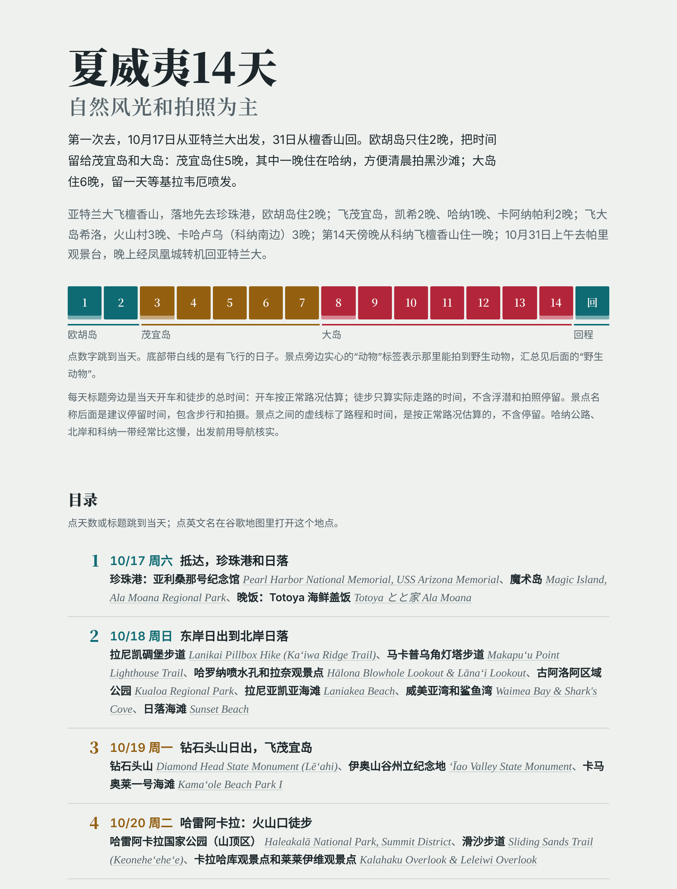
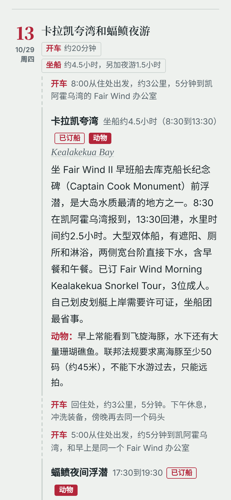

# itinera

一个单文件的旅行行程单网页模板：按天排的时间线，按地区分颜色，带深色模式，手机上也好读，每个地点的英文名一点就在谷歌地图里打开。

A single-file HTML travel itinerary template: a day-by-day timeline, color-coded regions, dark mode, mobile-friendly, and every place links to Google Maps.

<p>
  
  
</p>

完整示例：[examples/hawaii-14-days.html](examples/hawaii-14-days.html)，一次夏威夷14天的真实行程，确认号、订单号、姓名和房东联系方式都已换成占位。

## 快速开始

1. 下载 [`template.html`](template.html)，用任何文本编辑器打开。
2. 搜索“【”，把【】里的内容换成你的行程；`MM/DD`、`周X`、`约X` 也要换。
3. 用浏览器打开就能看。整份是一个文件，不需要安装任何东西，可以直接发给同行的人，或存在手机上离线看，地图链接照样能点。

## 文件

| 文件 | 说明 |
| --- | --- |
| `template.html` | 空白模板，排版和配色同示例，要填的地方都用【】标出来，文件开头的注释写了怎么改 |
| `examples/hawaii-14-days.html` | 填好的完整示例：夏威夷14天（欧胡岛、茂宜岛、大岛） |
| `docs/` | README 里的截图 |

## 整体结构

1. **标题区**：行程名（如“夏威夷14天”）+ 一句话重点（“自然风光和拍照为主”）+ 一段概述：哪天从哪出发、每个地方住几晚、为什么这样分。
2. **路线**：一段话从头说到尾，哪天飞哪、住哪、最后怎么回。
3. **每日导航**：一排数字 1 到 N，点一下跳到那天；有飞行的日子做个标记；按地区分颜色。
4. **读法说明**：标题旁的开车/徒步总量怎么算，景点后的停留时间包含什么，标签是什么意思（已订、动物、可选、从第N天挪来）。
5. **目录**：每天一行，日期 + 主题 + 当天所有站点（中文和英文）。
6. **出发前先看近期情况**：写上“信息截至哪天”，再列几条会影响行程的近况（台风、封路、火山、季节）。
7. **按地区分组的每日行程**：每个岛或城市一个大标题（中文 + 当地名），下面一句话写第几天到第几天、住哪、哪里取还车，然后是当地的每一天（格式见下一节）。
8. **汇总和专题**：野生动物、这次没排的知名风景、要提前订的、专题（如“火山怎么安排”）、拍摄和实用信息（月相、器材、天气和衣服、住宿、停车防盗、时差）。
9. **来源**：最后一句写信息来自哪些官方网站，截至哪天。

## 每天的写法

每天一块，按时间顺序“路段、景点、路段、景点”交替往下排，最后写提示。复制下面这段，替换尖括号里的内容；用不到的行直接删掉。

```
第N天 · MM/DD 周X：<当天主题>
总量：开车约X小时X分钟 · 徒步约X公里 · 飞行约X小时 · 坐船约X小时
交通：<当天怎么走，如“租车自驾；上午还车，13:05 航班飞往XX”>

开车 · HH:MM 从<住处>出发，约X公里，X分钟
<景点中文名>  停留约X小时（HH:MM到HH:MM） [已订票] [动物] [可选]
  <English Name>（链接到地图）
  <一两句话：看什么、怎么走、注意什么；订了的写清订了哪一项、几人>
  动物：<可能看到什么，保持多远>
  拍摄：<机位、最佳光线时间、镜头>
步行 · 约X米，X分钟
<下一个景点> ……
开车 · 回<住处>，约X公里，X分钟

吃饭：<当地特色餐厅、推荐菜、营业时间、要不要预约>
住宿：<住哪、入住或退房时间、注意事项>
后备：<下雨、关闭、取消时换成什么>
实际：<出发后实际有变化，事后补记>
```

填写时的几条规矩：

- **总量**只写当天有的项；开车按每段路相加，徒步只算走路的距离。
- **开车时间**写到分钟；查不到精确值的写“约X分钟（估算）”。
- **停留时间**包含在景点里走路、拍照的时间。
- **英文名**链接到地图搜索：`https://www.google.com/maps/search/?api=1&query=<英文名+所在地>`，到了当地直接点开导航。
- **标签**：已订票、已订船、已订团、已订（已付款或已预约）；动物（可能见到野生动物）；可选（时间紧可以跳过）；从第N天挪来（调整过的行程）。
- 门禁码、卫生间密码、卡号之类不写进行程单，分享出去也安全。

## 示例：第13天

这是夏威夷行程单里的一天，照上面的模板填好就是这样。

```
第13天 · 10/29 周四：卡拉凯夸湾和蝠鲼夜游
总量：开车约20分钟 · 坐船约4.5小时，另加夜游1.5小时
交通：租车自驾

开车 · 8:00 从住处出发，约3公里，5分钟到凯阿霍乌湾的 Fair Wind 办公室
卡拉凯夸湾  坐船约4.5小时（8:30到13:30） [已订船] [动物]
  Kealakekua Bay（链接到地图）
  坐 Fair Wind II 早班船去库克船长纪念碑前浮潜，是大岛水质最清的地方之一。
  8:30报到，13:30回港，水里时间约2.5小时。大型双体船，有遮阳、厕所和淋浴。
  已订 Fair Wind Morning Kealakekua Snorkel Tour，3位成人。自己划皮划艇上岸需要许可证。
  动物：早上常能看到飞旋海豚。联邦法规要求离海豚至少50码（约45米），不能下水游过去，只能远拍。
开车 · 回住处，约3公里，5分钟。下午休息，冲洗装备
开车 · 17:00 从住处出发，约5分钟，和早上是同一个办公室
蝠鲼夜间浮潜  17:30到19:30 [已订船] [动物]
  Manta ray night snorkel
  已订 Fair Wind 的 Hula Kai，3人。坐船约5分钟到蝠鲼村（Manta Village），天黑后扶着发光的漂浮平台，
  看蝠鲼在灯光下翻滚吃浮游生物。提供防寒泳衣。
  拍摄：带运动相机或防水壳。
开车 · 回住处，约5分钟。住处晚上9点开始是安静时间

吃饭：早上的船含早餐和午餐；夜游上船后有热可可和热汤
停车：两场都是 Fair Wind，同一个办公室，停车场在 78-7106 Kamehameha III Rd
后备：上午的船因海况取消的话，改去两步浮潜点（Two Step），岸边下水，不用预约
```

## 汇总部分的格式

**要提前订的**：每个要抢票、要预约的项目一行，订好后把第三栏改成“已订”加日期。

| 项目 | 在哪订 | 什么时候订 |
| --- | --- | --- |
| 中文名 English name | 官网或平台，价格 | 提前多久、几点放票；订好后写“已订 MM/DD” |
| 住宿 Lodging | Airbnb、酒店官网 | 已订：<地点> MM/DD到MM/DD；<地点> MM/DD到MM/DD |

**野生动物**：每种动物一行，写清哪几天、哪个景点最有可能见到。

| 动物 | 在哪里 | 距离和注意 |
| --- | --- | --- |
| 绿海龟 Green sea turtle | 第2天拉尼亚凯亚海滩，第7天海龟镇，第12天卡哈卢乌 | 3米以上，不触碰，不挡它回海的路 |
| 飞旋海豚 Spinner dolphin | 第13天卡拉凯夸湾，早上 | 法定至少50码（约45米），不能游过去 |

**其他汇总**，用列表写就行：

- **这次没排的知名风景**：景点名 + 一句话为什么没排（太远、封闭、要长徒步）。
- **专题**（如“火山怎么安排”）：当地最特别、变数最大的事，写清怎么判断、哪天去、看不到时怎么办。
- **拍摄和实用信息**：月相 · 器材 · 天气和衣服 · 住宿 · 停车防盗 · 时差，每项一两句。
- **来源**：信息来自哪些官方网站，截至哪天。

## 版式和配色

网页模板里已经写好这套样式，下面是它的规则，方便换目的地时改，也方便让别人照着做。

**配色**：浅色和深色各一套，页面跟随手机或电脑的系统设置切换。

| 用途 | 浅色 | 深色 |
| --- | --- | --- |
| 页面底色 | #EEF1EE 浅灰绿 | #121A1D |
| “近期情况”框底色 | #F8FAF8 | #1A2427 |
| 正文 | #1D272B 深墨色 | #E4EAE7 |
| 次要文字 | #56636A | #A3B0AC |
| 分隔线 | #CBD3CF | #2E3B3F |
| 地区一（欧胡岛） | #0E6B74 青绿 | #5DBAC3 |
| 地区二（茂宜岛） | #946010 琥珀 | #E0A94F |
| 地区三（大岛） | #B3263A 火山红 | #F2687C |
| 地区四（备用） | #3D5A8A 石板蓝 | #8EADE0 |
| 色块上的字 | #FFFFFF 白 | #121A1D 深色 |

**地区色用在哪**：一个地区一种颜色，这个颜色贯穿当地的每一天，看颜色就知道在哪。

- 顶部日期条的色块和图例下划线
- 地区大标题和它上方的粗线
- 每天左边的大号天数，目录里的天数和日期
- 总量小框和路段里的“开车”“步行”两个字
- 标签的边框；“动物”标签是实心色块
- “动物：”和“拍摄：”两个前缀
- “出发前先看近期情况”框左边的粗线用地区三的颜色（火山红），起提醒作用

**字体**：

- 中文标题：粗宋体（Noto Serif SC）
- 英文地名：斜体衬线字（Newsreader），灰色
- 正文：系统黑体（苹方、微软雅黑），行距宽松

**版式**：

- 单栏，最宽 760px，手机上不会出现横向滚动
- 大标题随屏幕宽度缩放，副标题是一半大小的灰字
- 日期条每天一个等宽色块，有飞行的底部加一条白线；图例按各地区天数的比例分段
- 每天分左右两栏：左栏是大号天数加日期，右栏是内容；天与天之间一条细线
- 景点左边是实竖线，路段左边是虚竖线、小一号的灰字，把一天串成时间线
- 开车、徒步等总量做成带细边框的小方框，放在当天标题右边
- 表格在手机上可以左右滑动

**换目的地怎么选颜色**：

- 每个地区挑一个能代表当地的颜色，比如海用青蓝、沙漠用土黄、火山用红、雪山用冷灰蓝；几个颜色的色相要拉开。
- 浅色模式的地区色要够深：白字放在上面的对比度至少 4.5:1（夏威夷三色在 5.3:1 到 6.5:1 之间）。
- 深色模式用同一色相、更亮的版本，色块上改放深色字。
- 底色、文字、分隔线一般不用动。

## 模板怎么改

1. 用任何文本编辑器打开，搜索“【”，把【】里的内容换成你的行程；MM/DD、周X、约X 也要换。
2. 换配色：只改样式最上面的 `:root` 一段，浅色和深色各一套，`--r1` 到 `--r4` 就是地区一到地区四。
3. 改天数：日期条上的 `--days` 写总格数（含回程日）；图例上的 `--legend` 按每个地区的天数写，比如夏威夷是 `2fr 5fr 7fr 1fr`。
4. 加一天：复制一整段 `<article class="day">`，改 id（d1、d2……），再把日期条和目录里对应的一格、一行加上。
5. 加地区：复制一整段 `<section class="island r1">`，class 和 id 改成下一个地区（如 r4）。
6. 门禁码、卫生间密码、卡号之类不要写进来。

<p align="center"></p>

## 许可

[MIT](LICENSE)
